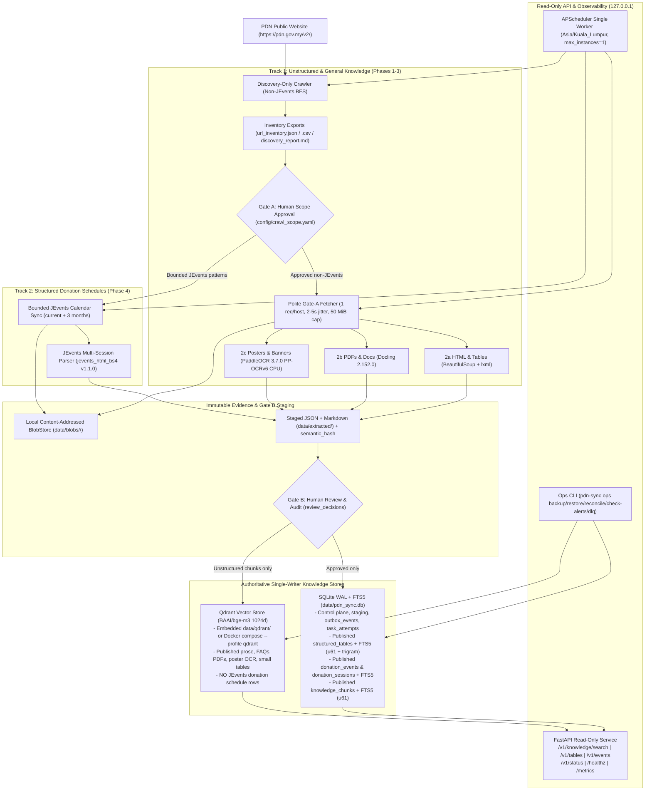
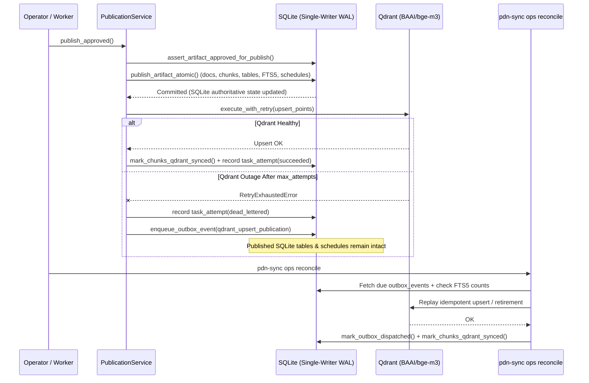

# Architecture — PDN Multimodal Knowledge Sync

> Single-writer, two-gate, two-track continuous knowledge ingestion system for Pusat Darah Negara (`https://pdn.gov.my/v2/`).
> Orchestration decisions are documented in [ADR-orchestration.md](decisions/ADR-orchestration.md); source-access and PDPA rules in [source-policy.md](source-policy.md); typed schemas in [data-contracts.md](data-contracts.md).

---

## 1. High-Level System Architecture

---

## 2. Two Mandatory Approval Gates (Code-Enforced)

1. **Gate A (`config/crawl_scope.yaml` — Single Source of Truth):**
   - Discovery (`pdn-sync discover`) enumerates candidate pages, posters, and documents without persisting page bodies or downloading asset bytes. Discovery never overwrites `config/crawl_scope.yaml`.
   - Every content fetch (`ApprovedContentFetcher`, `run_calendar_sync_pipeline`) compiles `config/crawl_scope.yaml` and fails closed on any `pending`, `excluded`, off-domain, private-IP, or oversized (>50 MiB) URL.
   - Explicit exclusions always override approvals. Runaway JEvents views (`eventsbyweek`, `eventsbyday`, `eventsbyyear`, `icalrepeat`, `search`, `?option=com_jevents*`) remain hard-excluded.
2. **Gate B (`staged_artifacts` + `review_decisions`):**
   - Every extractor emits typed `ExtractionResult` JSON + human-readable Markdown under `data/extracted/` and computes a deterministic `semantic_hash` (normalizing whitespace/chrome while preserving meaningful text, tables, OCR lines, and structured schedule fields).
   - `PublicationRepository.publish_artifact_atomic()` and `StagingRepository.assert_artifact_approved_for_publish()` re-verify the staged JSON file's recomputed `semantic_hash` against the recorded human `review_decisions` hash inside the write transaction.
   - Pending, rejected, quarantined, tampered, or stale (`version_seq < active`) versions are blocked at the database layer and can never enter active SQLite tables, FTS5 indexes, or Qdrant.
   - Unchanged meaning across re-fetches or extractor upgrades carries approval forward with an audited `carried_forward` decision; meaningful changes invalidate prior approval and flag active published records with `pending_change=true` until reviewed.

---

## 3. Publish, Outage Retry, and Outbox Reconciliation Sequence

---

## 4. Storage Ownership & Boundary Rules

| Store | Location | Authoritative Contents | Never Stored Here |
|---|---|---|---|
| **Crawl Scope YAML** | `config/crawl_scope.yaml` | Gate A exact URLs, bounded rotating-asset patterns, explicit exclusions | Runtime transient state |
| **Ingestion Policy YAML** | `config/ingestion_policy.yaml` | Politeness, discovery bounds, OCR thresholds, critical-fact keywords, indexing/retrieval mode, retry & alert thresholds | Credentials or secrets |
| **BlobStore** | `data/blobs/<sha256[:2]>/<sha256>` | Immutable raw bytes of Gate-A-approved HTML, PDFs, and posters | Unapproved assets, discovery HTML |
| **Staging Artifacts** | `data/extracted/<category>/` | Reviewable JSON + Markdown (`ExtractionResult`) | Active serving indexes |
| **SQLite (WAL + FTS5)** | `data/pdn_sync.db` | Control plane (`sync_runs`, `crawl_resources`, `scope_decisions`), staging & audit (`staged_artifacts`, `review_decisions`), reliability (`task_attempts`, `outbox_events`), published `structured_tables`, published `donation_events`/`donation_sessions`, FTS5 (`unicode61 remove_diacritics 2` + `trigram`) | Unapproved rows inside active/FTS5 tables |
| **Qdrant** | `data/qdrant/` or `http://127.0.0.1:6333` | Approved unstructured chunks (`BAAI/bge-m3`, 1024d): articles, FAQs, PDFs, poster OCR, small informational tables (≤30 rows) | Pending/rejected/quarantined/retired artifacts, JEvents donation schedule rows |

---

## 5. Read-Only Chatbot HTTP API Contract (`127.0.0.1:8000`)

All serving endpoints are strictly read-only (`GET`), bind to `127.0.0.1` by default, propagate `X-Request-ID` correlation headers, and return **only** `status == 'published'` (non-superseded, non-retired) records with canonical `source_url`, `last_verified_at`, `source_effective_date`, and `pending_change`:

- `GET /v1/knowledge/search?q=...&lang=ms|en|any&category=...&limit=1..20` — Unstructured knowledge search (dense `BAAI/bge-m3` or hybrid Dense + SQLite FTS5 BM25 RRF per `config/ingestion_policy.yaml`).
- `GET /v1/tables?q=...&source_url=...&limit=1..20` — Published structured HTML/PDF/poster tables (SQLite FTS5 `unicode61` → `trigram` → RapidFuzz).
- `GET /v1/events?date=YYYY-MM-DD&date_from=...&date_to=...&state=...&q=...&limit=1..50` — Published JEvents blood donation sessions (SQLite B-tree filters + FTS5 `unicode61`/`trigram` + RapidFuzz; raw cells preserved).
- `GET /healthz` — SQLite + Qdrant liveness/readiness and active point count.
- `GET /v1/status` — Published counts, Gate B backlog counts/age, FTS5 mismatches, DLQ count, active `alerts[]`, and last completed sync runs per profile.
- `GET /metrics` — Localhost-only Prometheus text exposition (`pdn_sync_*` operational gauges + API request counters/latency histograms).
